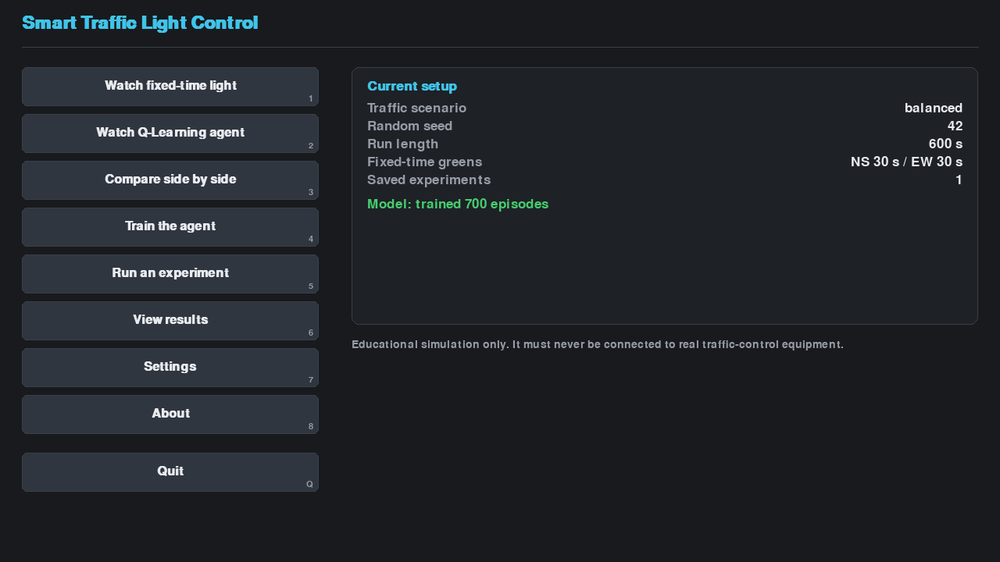
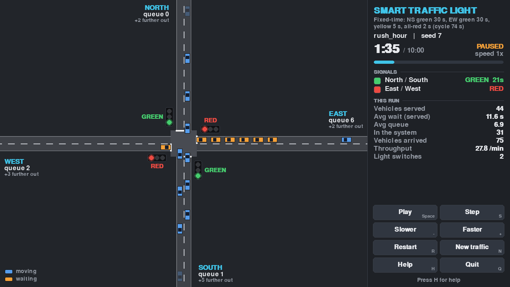
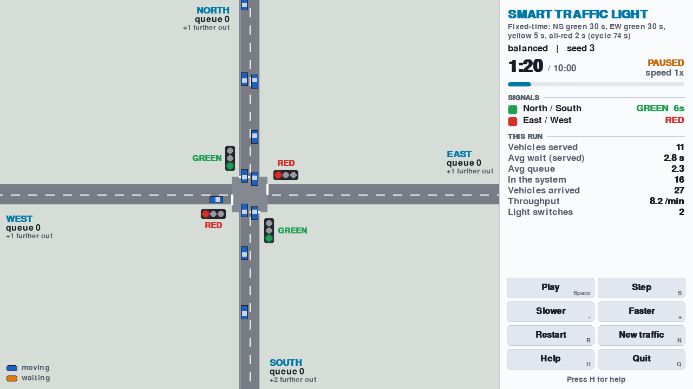
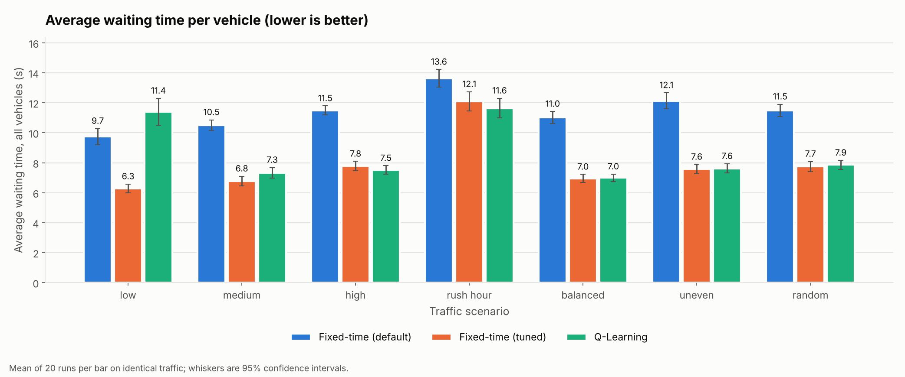

# 🚦 Smart Traffic Light Control Using Reinforcement Learning

<div align="center">

<a href="https://github.com/">
  
</a>

**An intelligent traffic simulation powered by Tabular Q-Learning**

Explore how reinforcement learning makes traffic-control decisions, visualize vehicle movement, and compare a learned policy against traditional fixed-time traffic signals under identical simulated conditions.

<br>


<br>

**[Quick Start](#-quick-start) · [Features](#-key-features) · [Experiments](#-experimental-results) · [Documentation](#-documentation)**

</div>

---

## 🚦 Project Overview

Traditional traffic lights use predefined timings regardless of how many vehicles are waiting. This project explores whether a reinforcement-learning agent can make better switching decisions by observing traffic conditions and learning from rewards.

The application simulates a four-way intersection with two non-conflicting traffic phases:

- **North–South:** vehicles travelling from the north and south approaches.
- **East–West:** vehicles travelling from the east and west approaches.

A tabular Q-Learning agent observes traffic levels, chooses whether to keep the current phase or request a switch, and learns a policy through repeated simulation.

The learned policy is evaluated against both the default fixed-time controller and a tuned fixed-time controller. All controllers receive identical seeded traffic during each paired experiment.

> **⚠️ Educational simulation only**
>
> This project is designed exclusively for academic learning, experimentation, and simulation. It must never be connected to real traffic signals, road infrastructure, or live traffic-control equipment.

## 🎬 See the Simulation

<div align="center">

### Main Application



*An interactive application for simulation, training, experiments, results, and settings.*

### Traffic Simulation — Dark Theme



### Traffic Simulation — Light Theme



</div>

The interface lets you observe vehicles, traffic signals, queues, simulation time, and live performance statistics while controlling playback speed.

## ✨ Key Features

<table>
<tr>
<td width="50%" valign="top">

### 🧠 Reinforcement Learning

- Tabular Q-Learning agent
- 18 discrete environment states
- Two actions: `KEEP` and `SWITCH`
- Epsilon-greedy exploration
- Configurable reward parameters
- Model saving and loading
- Best-policy selection using separate validation traffic

</td>
<td width="50%" valign="top">

### 🚘 Traffic Simulation

- Four-way intersection
- Seeded and reproducible traffic
- Seven traffic scenarios
- Smooth acceleration and braking
- Vehicle spacing and queue management
- Yellow and all-red transitions
- Minimum and maximum green constraints

</td>
</tr>
<tr>
<td width="50%" valign="top">

### 📊 Experiments & Analytics

- Default fixed-time baseline
- Tuned fixed-time baseline
- Trained reinforcement-learning controller
- Paired comparisons on identical traffic
- Mean performance and 95% confidence intervals
- CSV, JSON, Markdown, and PNG exports

</td>
<td width="50%" valign="top">

### 🎮 Interactive Desktop UI

- Main menu and simulation viewer
- Side-by-side controller comparison
- Training and experiment screens
- Results browser
- Settings editor
- Dark and light themes
- Pause, resume, step, replay, and speed controls

</td>
</tr>
<tr>
<td width="50%" valign="top">

### 🛡️ Safety & Reliability

- Signal transitions enforced by the simulator
- Conflicting green phases prevented
- Validated configuration values
- Defensive model-file loading
- Safe training interruption
- Clear error messages and logging

</td>
<td width="50%" valign="top">

### 🧪 Testing & Documentation

- 578 passing automated tests
- Deterministic simulation checks
- Controller fairness checks
- Interface and rendering tests
- Documentation consistency tests
- Developer guide, project report, and viva preparation

</td>
</tr>
</table>

## 📈 Experimental Results

The project evaluates controllers using the same traffic seeds to make the comparison fair.

### Reported findings

Based on the project's existing results from **20 runs across seven scenarios**, using average waiting time for all vehicles:

- Q-Learning reduces average waiting time by **15–37% compared with the default 30/30-second fixed-time controller in six of seven scenarios**.
- A tuned fixed-time controller performs approximately as well as Q-Learning in most scenarios.
- Q-Learning performs better than the tuned fixed-time controller in rush hour, with a reported improvement of **3.8%**.
- The agent shows no clear difference in four scenarios and performs worse in low- and medium-traffic scenarios.

These results demonstrate why a learned controller should be compared with a tuned baseline, rather than only with a basic timer.

<div align="center">



*Average waiting time by traffic scenario. See the generated experiment report for numerical results.*

</div>

### What the experiment measures

| Metric | What it tells us |
|---|---|
| Average waiting time | Time vehicles spend waiting, including vehicles still stuck |
| Average travel time | Time required for vehicles to complete their journeys |
| Throughput | Number of vehicles served |
| Queue length | Number of vehicles waiting for passage |
| Number of stops | How often vehicles come to a stop |
| Improvement percentage | Relative change against a selected baseline |
| Confidence interval | Uncertainty around the estimated mean performance |

Both served-vehicle waiting time and all-vehicle waiting time are reported. This prevents a controller from appearing successful simply because it leaves difficult-to-serve vehicles behind.

> Results are specific to this simulator, its reward function, traffic-generation model, and tested scenarios. They do not establish that reinforcement learning will outperform conventional traffic control in real-world deployments.

## 🧰 Technology Stack

| Technology | Purpose |
|---|---|
| Python 3.11+ | Core application and simulation |
| Pygame | Interactive desktop visualization |
| Matplotlib | Experiment graphs |
| Tabular Q-Learning | Reinforcement-learning algorithm |
| Python standard library | Simulation, configuration, logging, statistics, and testing |
| `unittest` | Automated testing |
| JSON | Settings and trained-model storage |
| CSV | Training logs and experiment data |
| Markdown | Human-readable reports and documentation |

The project does not require a GPU or a large machine-learning framework. The Q-table contains only **18 states × 2 actions = 36 state-action values**, making it suitable for a lightweight academic project.

## 🚀 Quick Start

### Prerequisites

- Python 3.11 or newer
- Git, if cloning the repository
- Pygame for the graphical interface
- Matplotlib for PNG experiment graphs

The headless simulation, metrics, training, experiments, and settings functionality use the Python standard library. Without Matplotlib, graph images are skipped.

### 1. Clone the repository

```powershell
git clone <YOUR_REPOSITORY_URL>
cd smart-traffic-rl
```

Replace `<YOUR_REPOSITORY_URL>` with the actual Git repository URL.

Alternatively, download the repository ZIP and extract it into a folder.

### 2. Create a virtual environment

```powershell
python -m venv .venv
```

### 3. Activate the environment

```powershell
.venv\Scripts\Activate.ps1
```

If PowerShell blocks activation, use the following command in the current terminal session, if permitted by your system policy:

```powershell
Set-ExecutionPolicy -Scope Process -ExecutionPolicy Bypass
.venv\Scripts\Activate.ps1
```

### 4. Install dependencies

```powershell
python -m pip install --upgrade pip
pip install -r requirements.txt
```

### 5. Launch the application

```powershell
python main.py --menu
```

You can also inspect the available command-line options:

```powershell
python main.py --help
```

## 🎮 Useful Commands

Run these commands from the project root with the virtual environment activated.

<details>
<summary><strong>🖥️ Launch and control the simulation</strong></summary>

```powershell
# Show the command-line overview
python main.py

# Open the complete application
python main.py --menu

# Watch the fixed-time controller
python main.py --window

# Start a rush-hour simulation at 5x speed, initially paused
python main.py --window --scenario rush_hour --speed 5 --paused

# Generate a screenshot without opening a window
python main.py --screenshot docs\images\frame.png --screenshot-at 90

# List available traffic scenarios
python main.py --list-scenarios
```

</details>

<details>
<summary><strong>🧠 Train and inspect the Q-Learning agent</strong></summary>

```powershell
# Train the agent for 300 episodes
python main.py --train --scenario rush_hour --episodes 300

# Inspect the saved policy
python main.py --model-info

# Run the trained agent in headless mode
python main.py --demo --controller rl --scenario rush_hour

# Watch the trained agent
python main.py --window --controller rl

# Demonstrate the RL environment using a random agent
python main.py --env-demo --duration 300
```

Training saves the learned model to `models/q_learning_model.json`. The training workflow validates candidate policies on separate traffic seeds and retains the best validated policy it finds.

</details>

<details>
<summary><strong>📊 Run experiments and compare controllers</strong></summary>

```powershell
# Compare fixed-time, tuned fixed-time, and RL controllers
python main.py --experiment --experiment-scenarios all --runs 20

# Run experiments without a trained RL model
python main.py --experiment --no-rl

# Run a standard fixed-time demonstration
python main.py --demo

# Run a seeded rush-hour demonstration
python main.py --demo --scenario rush_hour --duration 300 --seed 7

# Change the fixed-time baseline's green durations
python main.py --demo --ns-green 20 --ew-green 40
```

Experiment outputs are saved under a timestamped directory in `results/`. The generated files include summaries, raw data, statistics, and graphs when Matplotlib is available.

</details>

<details>
<summary><strong>⚙️ Configure the application</strong></summary>

```powershell
# Create the user settings file
python main.py --write-settings
```

Edit `config/user_settings.json` to override the settings you want to change.

Example:

```json
{
  "traffic": {
    "scenario": "rush_hour",
    "seed": 7
  },
  "simulation": {
    "duration": 300
  },
  "lights": {
    "min_green": 8,
    "max_green": 45
  },
  "fixed": {
    "ns_green": 25,
    "ew_green": 35
  }
}
```

Settings are validated when loaded. Invalid values, unsupported scenarios, incorrect types, and out-of-range parameters produce explanatory errors.

</details>

<details>
<summary><strong>🧪 Run the automated tests</strong></summary>

```powershell
python -m unittest discover -s tests -t .
```

The existing test suite reports 578 passing tests. The documented coverage run exercised 97% of the code; coverage and test counts should be rechecked after future changes.

</details>

## 🧠 How Reinforcement Learning Works

The agent interacts with a simulated environment through a repeated cycle:

```text
       ┌───────────────────────────┐
       │ Observe traffic conditions│
       └─────────────┬─────────────┘
                     ▼
       ┌───────────────────────────┐
       │ Encode one of 18 states   │
       └─────────────┬─────────────┘
                     ▼
       ┌───────────────────────────┐
       │ Select KEEP or SWITCH     │
       └─────────────┬─────────────┘
                     ▼
       ┌───────────────────────────┐
       │ Simulator enforces safety │
       └─────────────┬─────────────┘
                     ▼
       ┌───────────────────────────┐
       │ Calculate reward and next │
       │ state                     │
       └─────────────┬─────────────┘
                     ▼
       ┌───────────────────────────┐
       │ Update the Q-table        │
       └─────────────┬─────────────┘
                     │
                     └──── Repeat
```

### State space

The state combines three pieces of information:

- North–South traffic level
- East–West traffic level
- Current traffic-light phase

This gives the environment 18 possible discrete states.

### Actions

| Action | Meaning |
|---|---|
| `KEEP` | Request that the current phase remain active |
| `SWITCH` | Request a change to the other phase |

The agent requests a switch; it does not directly control the signal hardware or override the simulator's safety rules.

### Reward

The reward considers the reduction in waiting vehicles, a penalty for switching phases, and an excess-queue penalty. This encourages the agent to reduce congestion without switching unnecessarily.

### Q-Learning update

The standard Q-Learning update is:

\[
Q(s,a) \leftarrow Q(s,a) +
\alpha \left[r+\gamma\max_{a'}Q(s',a')-Q(s,a)\right]
\]

Where:

- \(s\) is the current state.
- \(a\) is the selected action.
- \(r\) is the reward.
- \(s'\) is the next state.
- \(\alpha\) is the learning rate.
- \(\gamma\) is the discount factor.

During training, epsilon-greedy exploration balances trying different actions with choosing actions that currently have high Q-values. During evaluation, the trained controller acts greedily with exploration disabled.

For the complete state definitions, reward formula, thresholds, and update details, see [RL Environment](docs/RL_ENVIRONMENT.md) and [Q-Learning Explained](docs/Q_LEARNING.md).

## 🚦 Traffic-Light Safety

The traffic-light state machine—not the learning agent—enforces the signal-transition rules.

Every phase change follows:

**GREEN → YELLOW → ALL-RED → GREEN**

The simulator includes:

- Minimum green duration
- Maximum green duration
- Yellow clearance
- All-red clearance
- Prevention of conflicting green phases
- Validation of clearance settings
- Safe handling of early or repeated switch requests

Vehicles stop at red signals, respond to yellow according to the modeled stopping rule, maintain following distances, and move through the intersection according to the simulation's signal state.

The simulator also checks that vehicles from conflicting road pairs do not occupy the crossing box simultaneously.

**Important:** These are safety invariants of an educational model, not certification of a real-world traffic controller.

## 🔬 Experimental Methodology

The experiment runner compares three controller configurations:

| Controller | Purpose |
|---|---|
| Default fixed-time | Establishes a simple 30/30-second green-time baseline |
| Tuned fixed-time | Uses separate tuning traffic to find better fixed green durations |
| Q-Learning | Evaluates the learned policy without exploration |

The comparison uses identical traffic seeds for all controllers within each paired run. Traffic generation depends on the scenario, seed, and simulation clock rather than the controller's decisions.

The workflow reports mean performance, 95% confidence intervals, and paired seed-by-seed comparisons. Tuning uses separate seeds to reduce the risk of giving the tuned baseline an unfair advantage on its evaluation traffic.

This is a simulation-based evaluation, not a claim of real-world traffic improvement.

## 🏗️ Project Architecture

```text
smart-traffic-rl/
│
├── main.py
│
├── config/
│   └── settings.py
│
├── controllers/
│   ├── base.py
│   ├── fixed_controller.py
│   ├── rl_controller.py
│   └── tuning.py
│
├── agents/
│   └── q_learning.py
│
├── environment/
│   ├── enums.py
│   ├── vehicle.py
│   ├── road.py
│   ├── traffic_light.py
│   └── rl_env.py
│
├── simulation/
│   ├── traffic_generator.py
│   ├── simulator.py
│   ├── runner.py
│   ├── headless_demo.py
│   └── env_demo.py
│
├── training/
│   ├── trainer.py
│   └── workflow.py
│
├── evaluation/
│   ├── metrics.py
│   ├── seeds.py
│   ├── stats.py
│   ├── experiment.py
│   ├── export.py
│   ├── graphs.py
│   └── formatting.py
│
├── ui/
│   ├── app.py
│   ├── jobs.py
│   ├── settings_form.py
│   ├── results_data.py
│   ├── screens/
│   ├── theme.py
│   ├── geometry.py
│   ├── snapshot.py
│   ├── session.py
│   ├── components.py
│   ├── scene.py
│   ├── hud.py
│   └── simulation_screen.py
│
├── utils/
├── tests/
├── docs/
│   └── images/
│
├── models/
├── results/
├── logs/
│
├── requirements.txt
├── README.md
├── LICENSE
└── .gitignore
```

### Main components

- **`environment/`** — vehicle behavior, roads, traffic signals, and the RL environment.
- **`simulation/`** — seeded traffic generation and episode execution.
- **`agents/`** — Q-table, exploration, updates, and model persistence.
- **`controllers/`** — shared controller interface, fixed-time logic, RL decisions, and tuning.
- **`training/`** — episode training, validation, logging, and best-policy selection.
- **`evaluation/`** — metrics, paired experiments, statistical summaries, and exports.
- **`ui/`** — desktop screens, drawing, controls, and background jobs.
- **`tests/`** — unit, integration, regression, and application behavior tests.
- **`docs/`** — project report, guides, methodology, and supporting screenshots.

## 🧪 Testing & Quality Assurance

The project's automated suite contains **578 passing tests** according to the current project results.

The tests cover:

- Vehicle movement, spacing, road capacity, and traffic generation.
- Red-light compliance and conflicting-traffic safety.
- Reproducibility with identical seeds.
- Fixed-time phase durations and controller behavior.
- RL state encoding, reward calculations, and Q-Learning updates.
- Training, interruption, validation, and model persistence.
- Fair comparisons between controllers.
- Statistical calculations and exported files.
- User-interface interactions, themes, window sizes, and screenshots.
- Invalid configuration, corrupted models, and error handling.
- Documentation consistency with implementation.

The documented coverage run reached 97%. The project also reports deliberately injected bugs that were detected by regression tests.

Run the suite yourself before submitting or releasing a modified version:

```powershell
python -m unittest discover -s tests -t .
```

See the [QA Checklist](docs/QA_CHECKLIST.md) for the documented checks and their limitations.

## 📂 Documentation

| Document | Description |
|---|---|
| [User Guide](docs/USER_GUIDE.md) | Installation, operation, training, experiments, and results |
| [Developer Guide](docs/DEVELOPER_GUIDE.md) | Architecture, implementation, and extension points |
| [RL Explained](docs/RL_EXPLAINED.md) | Plain-language explanation of the learning process and learned policy |
| [Project Report](docs/PROJECT_REPORT.md) | Academic project report and experimental findings |
| [Viva Questions](docs/VIVA_QUESTIONS.md) | Oral examination preparation |
| [Experiments](docs/EXPERIMENTS.md) | Evaluation methodology, seeds, and experiment outputs |
| [Metrics](docs/METRICS.md) | Metric definitions and calculation formulas |
| [RL Environment](docs/RL_ENVIRONMENT.md) | State space, actions, reward, and environment behavior |
| [Q-Learning](docs/Q_LEARNING.md) | Update rule, exploration, model format, and training |
| [User Interface](docs/USER_INTERFACE.md) | Screens, keyboard shortcuts, and interaction design |
| [Reliability](docs/RELIABILITY.md) | Input validation, damaged-file handling, and failure recovery |
| [Development Plan](docs/DEVELOPMENT_PLAN.md) | Project phases and implementation decisions |
| [QA Checklist](docs/QA_CHECKLIST.md) | Final quality-assurance scope and limitations |

## ⌨️ Simulation Controls

When the simulation window is open, use the following keyboard shortcuts:

| Key | Action |
|---|---|
| `Space` | Pause or resume; replay when the run finishes |
| `S` or `Right` | Run one simulation step, pausing first |
| `+` / `-` or `Up` / `Down` | Increase or decrease simulation speed |
| `1`–`5` | Set speed to 0.5×, 1×, 2×, 5×, or 10× |
| `R` | Restart using the same traffic |
| `N` | Generate new traffic using the next seed |
| `T` / `D` | Toggle statistics or debug information |
| `H` | Show keyboard help |
| `Esc` or `Q` | Close help, then quit |

The display uses blue for moving vehicles and orange for waiting vehicles. Traffic signals also display their state as text, so their meaning is not conveyed by color alone.

The visual layer interpolates motion between simulation steps. It does not change the underlying simulation decisions or metrics.

## ⚙️ Reproducibility

Reproducibility is central to the project's experimental design.

The same seed, scenario, and simulation configuration generate the same traffic sequence. This makes it possible to replay an episode, debug controller behavior, and compare policies on identical traffic.

For reliable comparisons:

1. Keep the simulation settings consistent.
2. Use identical evaluation seeds across controllers.
3. Keep tuning seeds separate from evaluation seeds.
4. Compare the same performance metrics.
5. Inspect the generated data rather than relying only on a graph.
6. Report limitations alongside improvements.

## ⚠️ Limitations & Future Work

### Current limitations

- One simulated four-way intersection.
- Straight-through vehicle movement only.
- Simplified vehicle and driver behavior.
- No pedestrians, emergency vehicles, cameras, or real traffic data.
- A small tabular state space and a limited action set.
- A tuned fixed-time controller matches or exceeds RL in several scenarios.
- The graphical interface has been tested off-screen on Linux; actual display smoothness remains unverified on the target machine.
- The documented testing environment is Linux with Python 3.13. Windows compatibility is expected, but has not yet been verified by a Windows test run.

### Possible extensions

- More complex intersections and turning movements.
- Pedestrian crossings and emergency-vehicle scenarios.
- Additional state representations and reward-function comparisons.
- Larger traffic networks and coordinated signals.
- More extensive parameter sensitivity analysis.
- Comparisons with additional conventional and learning-based methods.
- Validation against independently sourced traffic data.

These extensions would require additional testing and should not be presented as implemented features until they have been developed and evaluated.

## 🔐 Logging & Privacy

The application writes technical information to:

```text
logs/application.log
```

The current application is designed to work locally and offline. It does not intentionally collect or transmit application data to external services.

## 🛣️ Development Progress

All 11 documented implementation phases are complete.

| Phase | Deliverable | Status |
|---:|---|---|
| 1 | Project foundation and validated settings | ✅ Complete |
| 2 | Headless traffic simulation | ✅ Complete |
| 3 | Fixed-time controller and metrics | ✅ Complete |
| 4 | Pygame visualization | ✅ Complete |
| 5 | RL environment and safety enforcement | ✅ Complete |
| 6 | Q-Learning training and model persistence | ✅ Complete |
| 7 | Experiments, statistics, and exports | ✅ Complete |
| 8 | Application menu and interactive screens | ✅ Complete |
| 9 | Reliability and error handling | ✅ Complete |
| 10 | Tests and documentation | ✅ Complete |
| 11 | Final QA and rule audit | ✅ Complete |

For the detailed implementation history, see [Development Plan](docs/DEVELOPMENT_PLAN.md).

## 📜 License

This project is distributed under the MIT License. See [LICENSE](LICENSE) for the full terms.

Before publishing, replace any placeholder author information in the license file with the appropriate details.

---

<div align="center">

### 🚦 Simulate. Learn. Evaluate. Improve.

**Smart Traffic Light Control Using Reinforcement Learning**

An academic exploration of intelligent traffic management through simulation and data-driven evaluation.

<br>

*Built with Python · Powered by Q-Learning · Designed for experimentation*

</div>
