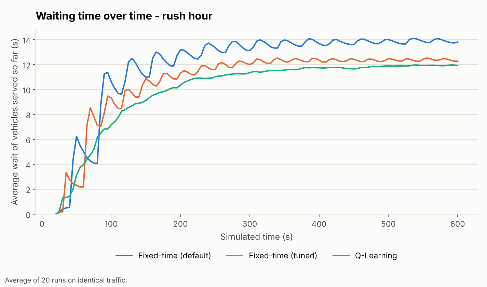

# Smart Traffic Light Control Using Reinforcement Learning

**Project report**

Author: _your name_ · Roll number: _…_ · Course: _…_ · Supervisor: _…_ · Date: _…_

(Fill in the line above. Everything below describes the project as it was actually built and measured.)

---

## Abstract

Traffic lights with fixed green times cannot react to the traffic that is actually waiting. This project builds a
simulated four-way intersection in Python and trains a tabular Q-Learning agent to decide, every five seconds, whether to
keep or switch the green. The agent is compared with two fixed-time controllers, the default 30 s / 30 s timer and a tuned
timer, on identical, seeded traffic in seven scenarios, with 20 runs per scenario and 95 % confidence intervals. The agent
lowered the average waiting time by 15 % to 37 % compared with the default timer in six of seven scenarios and was 17 %
worse in light traffic. Compared with the tuned timer it was clearly better only in rush hour (3.8 %), not different in four
scenarios and worse in light and medium traffic. The main conclusion is therefore modest and honest: the agent learned a
sensible rule (give green to the busier road) and clearly beats a poorly set timer, but does not beat a well-tuned timer
in most conditions. The simulation, the learning code, the experiment pipeline, a desktop application and 578 automated
tests are all part of the delivered software.

## 1. Introduction

### 1.1 Problem

At a fixed-time signal each direction gets a green of preset length regardless of demand. When one road is busy and the
other empty, green time is wasted and vehicles wait longer than necessary. Adaptive control tries to use the
current traffic to decide when to change.

### 1.2 Objectives

1. Build a safe, repeatable simulation of a four-way intersection with a fixed-time baseline.
2. Build a reinforcement-learning environment and a Q-Learning agent that can only *request* light changes.
3. Compare agent and baselines **fairly**: same traffic, separate seeds for training and testing, proper statistics.
4. Provide a usable application with settings, training, experiments and results, and make everything reproducible.
5. Report the results honestly, including where the agent does not help.

### 1.3 Scope and non-goals

One intersection, straight-through traffic, two phases (North/South and East/West), simulated vehicles only. No real data,
pedestrians, turning movements or emergency vehicles. The system is educational and must never be connected to real
traffic equipment.

## 2. Background

* **Fixed-time control**: the light cycles through preset phases. Simple and predictable, but blind to demand.
* **Reinforcement learning** (Sutton and Barto, *Reinforcement Learning: An Introduction*, 2nd ed., 2018): an agent
  learns a policy from rewards received while interacting with an environment.
* **Q-Learning** (Watkins and Dayan, *Machine Learning* 8, 1992): learns the value `Q(s, a)` of each state-action pair
  with the update `Q(s,a) ← Q(s,a) + α (r + γ max Q(s′,a′) − Q(s,a))`, and acts epsilon-greedily while learning.

A plain-language explanation using this project's numbers is in [RL_EXPLAINED.md](RL_EXPLAINED.md).

## 3. System design

### 3.1 Architecture

```
Settings ─► Simulator ─► Controller (fixed / tuned fixed / Q-Learning) ─► run_episode ─► metrics
                │                                                            │
                └─► TrafficEnv (state, actions, reward) ─► Trainer ─► QLearningAgent ─► model file
                                                                             │
Experiment runner (identical seeds) ─► statistics ─► CSV / JSON / Markdown / graphs ─► application screens
```

Packages: `environment` (vehicles, roads, light, RL wrapper), `simulation`, `controllers`, `agents`, `training`,
`evaluation`, `ui`, `config`, `utils`. The simulation core has no graphics dependency. See
[DEVELOPER_GUIDE.md](DEVELOPER_GUIDE.md).

### 3.2 Simulation

* Time step 0.5 s; four approach roads of 200 m; vehicles of 4.5 m with a 2 m minimum gap, top speed about 50 km/h with
  per-driver variation, smooth acceleration (2.5 m/s²) and braking (4 m/s²), and car-following.
* **Traffic light**: green → yellow (5 s) → all-red (2 s) → other phase. Minimum green 10 s, maximum green 60 s. Early
  requests are ignored; conflicting greens are impossible. Settings are rejected if yellow plus all-red is too short to
  clear the crossing.
* **Traffic**: seeded arrivals per road. Seven scenarios: low, medium, high, rush hour, balanced, uneven (north road
  busy) and random (rate rises and falls). Each road has its own random stream, so traffic depends only on scenario and
  seed, never on the light.
* **No lost vehicles**: arrivals that cannot enter a full road wait outside and keep accumulating waiting time.
* **Self-check**: every step verifies that vehicles from both road pairs are never in the crossing together.

### 3.3 Controllers

* **Fixed-time (default)**: 30 s green for each direction.
* **Fixed-time (tuned)**: the same kind of controller whose green times are chosen per scenario by grid search over
  10, 15, 20, 25, 30, 40, 50 s on separate tuning seeds. This is the honest baseline.
* **Q-Learning**: described next, run with exploration off.

### 3.4 Reinforcement-learning formulation

* **State** (18): North/South traffic level (low, medium, high) × East/West level × which pair has green. A level
  counts vehicles approaching the pair that have not crossed the stop line (thresholds 5 and 12).
* **Actions**: KEEP or SWITCH. A switch is a request the light may refuse.
* **Decision step**: every 5 s; after a switch the environment runs through yellow and all-red until the new green, so the
  agent only ever decides during steady green.
* **Reward**: `(waiting before − waiting after) − 2.0 × switches − 0.2 × max(0, waiting after − 30)`.
* **Learning**: α = 0.1, γ = 0.9, ε from 1.0 decaying by 0.995 per episode to 0.05.
* **Best-policy selection**: every 20 episodes the greedy policy is tried on four fixed validation runs and the best is
  kept, because the greedy policy of a still-learning table swings between good and poor (documented in
  [Q_LEARNING.md](Q_LEARNING.md)).

### 3.5 Application

A pygame application (`python main.py --menu`) with screens to watch either controller, compare them side by side on
identical cars, train (pause, stop and save, live charts), run experiments, view results, and edit validated settings.
Training and experiments run in background threads. See [USER_INTERFACE.md](USER_INTERFACE.md) and
[USER_GUIDE.md](USER_GUIDE.md).

## 4. Experimental method

* **Metrics**: average waiting time of all vehicles (main measure, includes vehicles still stuck at the end), average
  served waiting time, maximum waiting time, queue length (mean and maximum), vehicles served, throughput, travel time,
  stops per vehicle, light switches, and the training reward formula applied to every controller. Definitions in
  [METRICS.md](METRICS.md).
* **Fairness**: all controllers drive the same scenario, duration (600 s) and seed in every run; the program checks that
  every controller saw the same arrivals.
* **Seed ranges that never overlap**: training `base + i`; evaluation `base + 1,000,000 + k`; validation and tuning
  `base + 2,000,000 + k` (base seed 42). The agent and the tuned baseline never see the evaluation traffic while being
  chosen.
* **Training**: one model, 700 episodes, all seven scenarios mixed; its best policy came from episode 20 (validation
  waiting time 9.6 s).
* **Statistics**: 20 runs per controller and scenario; mean ± 95 % Student-t interval; paired seed-by-seed comparison. A
  verdict of *better* or *worse* is given only when the interval of the paired difference excludes zero, otherwise *no
  clear difference*. Improvement % = change of the mean relative to the baseline.
* **Safety**: safety conflicts were counted in every run: **0** in all runs.

The full experiment (7 scenarios × 20 runs × 3 controllers, plus tuning) took 85 s on the development machine.

## 5. Results

Average waiting time of all vehicles, seconds (mean ± 95 % interval, 20 runs, lower is better):

| Scenario | Fixed (default) | Fixed (tuned) | Q-Learning | RL vs default | RL vs tuned |
|---|---:|---:|---:|---|---|
| low | 9.7 ± 0.5 | 6.3 ± 0.3 | 11.4 ± 0.9 | −17.1 % (worse) | −81.4 % (worse) |
| medium | 10.5 ± 0.4 | 6.8 ± 0.3 | 7.3 ± 0.4 | +30.4 % (better) | −7.9 % (worse) |
| high | 11.5 ± 0.3 | 7.8 ± 0.3 | 7.5 ± 0.3 | +34.7 % (better) | +3.4 % (no clear difference) |
| rush hour | 13.6 ± 0.6 | 12.1 ± 0.6 | 11.6 ± 0.7 | +14.6 % (better) | +3.8 % (better, 15/20 runs) |
| balanced | 11.0 ± 0.4 | 7.0 ± 0.3 | 7.0 ± 0.3 | +36.6 % (better) | −0.5 % (no clear difference) |
| uneven | 12.1 ± 0.5 | 7.6 ± 0.3 | 7.6 ± 0.3 | +37.2 % (better) | −0.6 % (no clear difference) |
| random | 11.5 ± 0.4 | 7.7 ± 0.3 | 7.9 ± 0.3 | +31.6 % (better) | −1.6 % (no clear difference) |


Other measures (means; the full tables with intervals are in the experiment's `summary.md`):

| Scenario | Avg queue (veh): default / tuned / RL | Max waiting (s): default / tuned / RL | Light switches: default / tuned / RL |
|---|---|---|---|
| low | 1.5 / 1.0 / 1.7 | 39.6 / 20.6 / 65.8 | 16 / 35 / 11.5 |
| medium | 3.2 / 2.1 / 2.2 | 40.4 / 21.7 / 53.1 | 16 / 35 / 22.0 |
| high | 5.6 / 3.8 / 3.7 | 42.4 / 25.9 / 44.5 | 16 / 35 / 26.1 |
| rush hour | 10.2 / 9.1 / 8.8 | 48.1 / 42.1 / 47.2 | 16 / 22 / 26.8 |
| balanced | 4.2 / 2.6 / 2.7 | 41.2 / 23.5 / 48.1 | 16 / 35 / 24.9 |
| uneven | 4.6 / 2.9 / 2.9 | 44.3 / 31.2 / 62.8 | 16 / 27 / 19.3 |
| random | 4.3 / 2.9 / 2.9 | 42.5 / 27.4 / 53.5 | 16 / 35 / 22.3 |

Throughput was practically identical for all controllers (for example 41.4 / 41.7 / 42.0 vehicles per minute in rush
hour), because in these scenarios the intersection is not saturated: the controllers differ in how long vehicles wait,
not in how many get through.



## 6. Discussion

1. **The agent beats a badly chosen timer.** In six of seven scenarios the agent beat the default 30 s timer by a wide,
   statistically clear margin.
2. **That is mostly the weakness of the default.** A tuned timer, found on separate seeds, is about as good as the agent.
   Shorter greens already remove much of the waiting. (Most tuned greens were 10 s, the lowest candidate, which equals the
   light's minimum green; so the tuning range limits how good the baseline could be.)
3. **The agent learned something real.** Its table (see [RL_EXPLAINED.md](RL_EXPLAINED.md)) switches exactly when the road
   without green is busier than the road with it. That is adaptive behaviour no fixed timer has.
4. **Where it loses.** In light traffic the agent leaves a lone vehicle waiting longer (maximum waiting 65.8 s versus 20.6 s),
   A likely reason (not tested separately) is that the state cannot tell it that a road has been red for a long time, and the
   switch penalty makes it reluctant to change for one car. In the uneven scenario its maximum waiting time is also high (62.8 s versus 31.2 s tuned) although the
   average is the same: it favours the busy road at the expense of the quiet one.
5. **Reward is not the target.** Total reward ranks controllers differently from waiting time because it penalises switches;
   the tuned timer switches most often, so it scores worst on reward while vehicles wait least.

## 7. Limitations

* A single trained model; another training seed could give somewhat different numbers.
* The state does not include how long the current green has lasted, and the 18-state table cannot generalise.
* Tuning was limited to seven candidate green times and four tuning seeds per scenario.
* The simulation is simplified: one intersection, straight traffic, simple driver model, random arrivals at fixed average rates.
* Results were produced and tested on Linux; the window has not been run on a real display during development.

## 8. Conclusions and future work

The project delivered what it set out to: a safe, reproducible simulation; a working Q-Learning controller whose actions
cannot break safety rules; a fair experimental comparison with proper statistics; and a usable application. The agent
clearly outperforms a naive fixed timer but, against a tuned timer, offers a significant benefit only in rush hour.

Natural next steps, in order of expected value: (1) add the elapsed green time to the state so the agent can protect
quiet roads; (2) tune the reward, especially the switch penalty, against waiting time and maximum waiting time;
(3) train several models and report the spread; (4) widen the tuning grid and seeds; (5) replace the table with a function
approximator (for example DQN) using finer queue information; (6) add turns, pedestrians and several linked intersections.
None of these is implemented yet; they are stated as ideas, not results.

## 9. Reproducing the results

```powershell
python main.py --train --train-scenarios all --episodes 700
python main.py --experiment --experiment-scenarios all --runs 20
```

This writes `results/experiment_<time>_7_scenarios/` with `summary.md`, `runs.csv`, `summary.csv`, `comparison.csv`,
`experiment.json` and graphs. The same seeds give the same traffic, so a repeat gives the same fixed-time numbers; the
agent's numbers depend on the trained model. Training is itself seeded, so training with the same settings and seeds
gives the same model. The numbers in this report were re-checked against the final code for the rush-hour and low
scenarios with the original model (identical results).

## 10. Software summary

| Item | Value |
|---|---|
| Language and libraries | Python 3.11+, pygame (window), matplotlib (graphs), otherwise the standard library |
| Source size | about 8,800 lines in 60 modules, plus about 6,200 lines of tests |
| Automated tests | 578, passing on Python 3.11 and 3.13 |
| Documentation | README and the guides in `docs/` |
| License | MIT |

## References

* Sutton, R. S. and Barto, A. G. (2018). *Reinforcement Learning: An Introduction*, 2nd edition. MIT Press.
* Watkins, C. J. C. H. and Dayan, P. (1992). Q-learning. *Machine Learning*, 8, 279-292.
