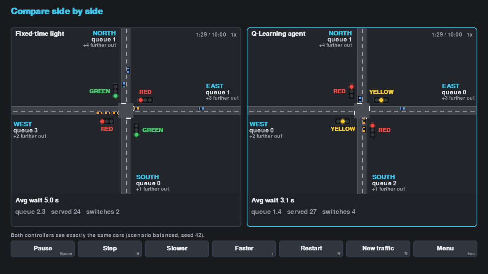
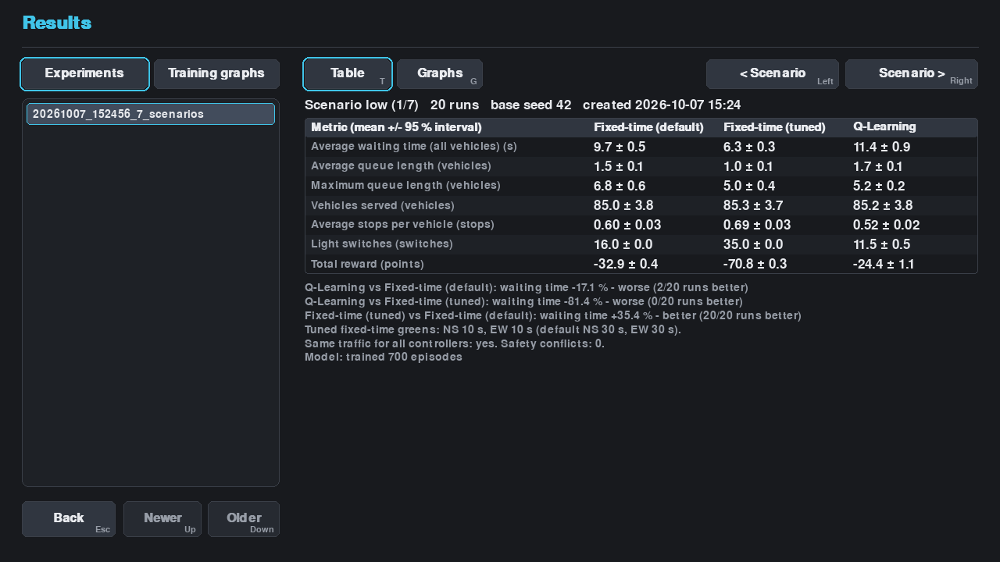
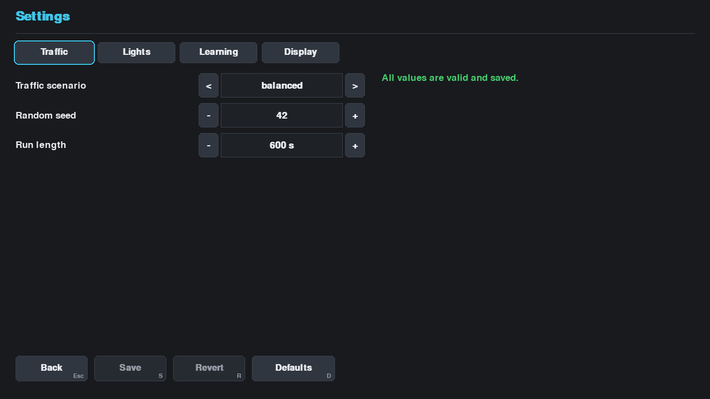

# The application (Phase 8)

`python main.py --menu` opens one window with a main menu. Each screen has a **Back** button (or Esc) and
every button has a keyboard key shown in its corner. Nothing is a placeholder: every button does what it says.

| Screen | What you can do |
|--------|-----------------|
| **Watch fixed-time light** / **Watch Q-Learning agent** | The simulation window from Phase 4 (play, pause, step, speed, restart, new traffic). *Menu* returns here. The agent needs a trained model. |
| **Compare side by side** | Fixed-time light and trained agent run on exactly the same cars, with live waiting time, queue, vehicles served and switches. When the run ends the page says how much lower or higher the agent's waiting time was, and that one run is not proof. |
| **Train the agent** | Choose episodes and scenarios, start, pause/resume, stop and save. Live reward and waiting-time charts, progress, time left. Never replaces an existing model without asking; can continue training the saved one. Saves the model, the CSV log and graphs. |
| **Run an experiment** | Choose scenarios and runs, optionally leave out the tuned fixed-time controller or the agent. Progress with time left; Stop keeps the runs that every controller finished. Saves the same files as `--experiment`, then **View results**. |
| **View results** | Saved experiments (newest first): table per scenario with 95 % intervals and verdicts, or the graphs; plus the training graphs. Damaged folders are listed with a reason, not a crash. |
| **Settings** | Traffic, Lights, Learning and Display pages. Step with the arrow buttons or click a number and type it. Every value is checked with the same rules as the settings file; problems are explained in plain English and nothing invalid can be saved. Save, Revert, Defaults (asks first); leaving with unsaved changes asks first. |
| **About** | What the program is, the safety rules, where files live. |

## Behaviour worth knowing

* Training and experiments run in a background thread, so the window stays responsive. Leaving or closing the window
  while one is running asks whether to stop it; stopping saves what was learned (training) or the finished runs (experiment).
* If a model is missing or damaged, the buttons that need it are disabled and say why when you hover them.
* The Results screen can delete an experiment or graph, and the Training screen can delete the model; each asks first and is disabled while training runs.
* The window cannot be made smaller than 640x480. If a screen hits an unexpected error it is logged and you return to the menu (details: `docs/RELIABILITY.md`).
* A changed theme applies as soon as you press Save.
* `python main.py --menu --screen settings` opens a screen directly; adding `--screenshot file.png` saves a picture
  without opening a window.
* The logic of each screen (jobs, settings form, results loading, training workflow) is plain Python in `ui/jobs.py`,
  `ui/settings_form.py`, `ui/results_data.py` and `training/workflow.py` and is tested without pygame.
